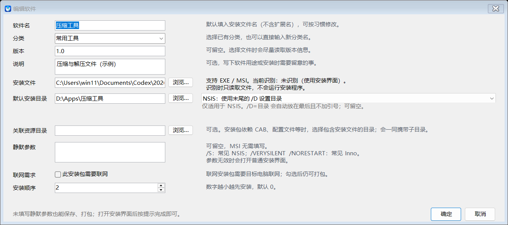
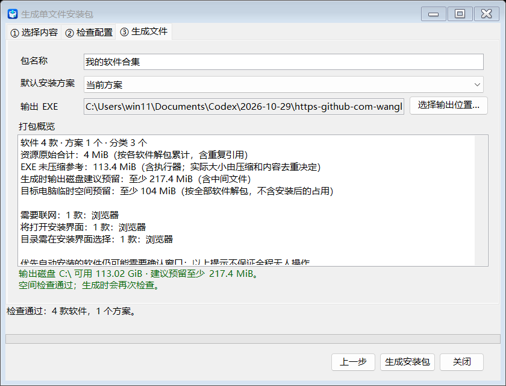

# 软件安装助理 (Software Installer Assistant)

当前版本：**v1.2.1**。下载完整的 [Windows x64 便携包](https://github.com/wanglanaaa/Software-Installer-Assistant/releases/tag/v1.2.1)，解压后运行 `软件安装助理.exe`；请保留 `Runner` 子目录及其他文件。


截图使用示例配置展示最新版界面；发布包不附带示例或第三方软件安装文件。

## 项目简介

“软件安装助理”是一个桌面应用程序，旨在帮助用户高效地管理和安装各类软件。它提供了一个直观的用户界面，允许用户对软件进行分类、管理安装方案，并支持智能化的静默安装。

## ✨ 主要功能

* **生成单文件安装包**：主界面底部点击「生成单文件安装包」，选择打包范围和附带方案，检查后输出 EXE。生成的安装包包含独立执行器和原始安装资源，可在其他 Windows x64 电脑选择方案并逐项安装，无需预装 .NET。生成前显示资源大小、空间需求及联网 / 手动操作提示。使用方法见 [安装包指南](docs/offline-bundle-guide.md)。

*   **分类、搜索与排序**：主列表显示全部软件，支持搜索和分类筛选；勾选决定安装范围。分类和软件可上移 / 下移，软件支持多选移动，顺序随配置保存。
*   **批量添加与软件信息管理**：多选或拖入 EXE / MSI，自动读取文件名、版本和大小，集中确认分类并跳过重复路径；双击软件可编辑常用设置。
*   **自动与普通安装**：
    *   MSI 自动使用标准参数；常见 NSIS / Inno 安装包通过只读识别选择参数，用户可留空。
    *   未识别时打开软件原有安装界面；静默执行失败时最多重试一次普通安装。取消或超时不会强制重试。
    *   无需勾选验证状态或填写返回码、检测规则等高级选项；软件信息页只保留十项常用字段，右侧直接提供使用说明。
*   **手动加载配置**：每次启动为空白，不自动读取前次分类和方案。通过「加载配置」恢复软件、分类和方案；「保存配置」首次选择 JSON 位置，「另存为」可换位置。配置之间相互独立，切换或退出时提示保存修改。
*   **配置搬家与路径修复**：保存时尽量使用相对安装源路径，支持整套目录搬家；旧路径失效时，指定原 / 新资源根目录，预览后批量修复当前列表和已保存方案。
*   **安装方案管理**：
    *   **保存方案**：将当前软件列表及勾选状态记为一个安装方案；点击上方「保存配置」写入 JSON，方便日后加载。
    *   **加载方案**：通过下拉框选择并自动加载已保存的安装方案，恢复软件的勾选状态。
    *   **删除方案**：管理和删除不再需要的安装方案。
*   **安装路径与状态**：支持默认安装目录，不能自动设置时提示在安装界面选择；安装时显示当前阶段、已处理数量及逐项结果。
*   **界面与图标**：按钮统一对齐，主程序及导出安装器使用高清 LOGO；生成前检查执行器版本，避免误用旧模板。

## 界面预览

### 软件设置

十项常用字段，右侧附简易说明，MSI 和未知安装器均可不填静默参数。



### 生成前的打包概览

资源大小和空间为生成前参考；实际 EXE 大小取决于压缩和去重。



### 生成后的单文件安装包界面

下面截图来自实际导出的 EXE，打开后选择方案并点击「一键安装」。联网和需要手动操作的项目会标注；不支持静默方式时打开软件原有安装界面。


## 🛠️ 技术栈

*   **C#**：主要开发语言。
*   **.NET 9.0**：应用程序框架。
*   **Windows Forms**：用于构建桌面用户界面。
*   **System.Text.Json**：用于方案和软件列表的序列化和反序列化。

## 📂 项目结构

项目采用分层结构，将不同的功能模块分离到独立的项目中，以实现高内聚、低耦合。

*   `SoftwareInstaller.UI`：用户界面层，包含主窗体 `MainForm`。
*   `SoftwareInstaller.Core`：软件数据、分类及方案管理。
*   `SoftwareInstaller.Models`：数据模型层，定义了如 `SoftwareItem` 等核心数据结构。
*   `SoftwareInstaller.Utils`：通用工具层，提供最底层的、与具体业务无关的辅助功能，如文件元数据读取、进程调用、错误处理和窗口检测等。
*   `SoftwareInstaller.Packaging`：打包、资源校验以及管理端/导出端共用的安装引擎。
*   `SoftwareInstaller.Runner`：生成 EXE 内使用的自包含安装界面。
*   `SoftwareInstaller.Tests`：无副作用的集成检查和界面布局验证。

## 🚀 如何运行

### 方式一：为普通用户 (推荐)

1.  前往本项目的 [**Releases 页面**](https://github.com/wanglanaaa/Software-Installer-Assistant/releases)。
2.  下载 `SoftwareInstaller-Assistant-v1.2.1-win-x64.zip`。
3.  将压缩包解压到你希望的任意位置。
4.  进入解压后的文件夹，双击运行 `软件安装助理.exe`。

### 方式二：为开发者

如果你希望自行编译或对代码进行修改，请遵循以下步骤：

1.  **环境准备**：确保你已安装 [.NET 9.0 SDK](https://dotnet.microsoft.com/download/dotnet/9.0) 或更高版本。
2.  **克隆仓库**：
    ```bash
    git clone https://github.com/wanglanaaa/Software-Installer-Assistant.git
    cd Software-Installer-Assistant
    ```
3.  **运行程序**：
    ```bash
    dotnet run --project SoftwareInstaller.UI
    ```

## 📝 未来计划 (TODO)

- [x] 软件列表搜索、批量添加和安装文件元数据读取。
- [ ] 提供更美观的自定义主题或皮肤功能。
- [x] 支持 MSI 标准静默安装及离线单文件 EXE 导出。
- [ ] 离线合集重启后续装、ARM64 和大容量分卷支持。

## 🤝 贡献

欢迎任何形式的贡献！如果您有任何建议或发现 Bug，请随时提交 Issue 或 Pull Request。

## 📄 许可证

[待定]
