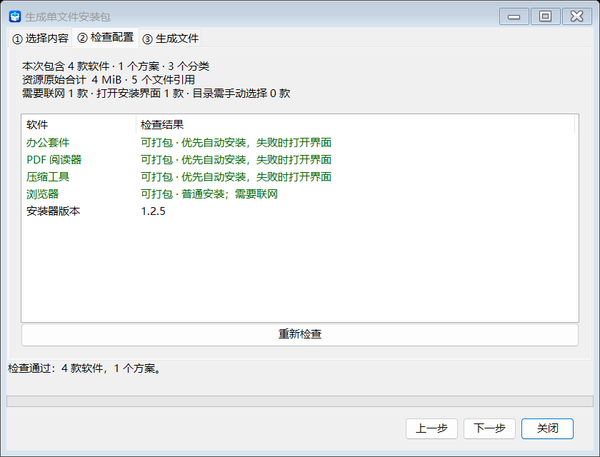
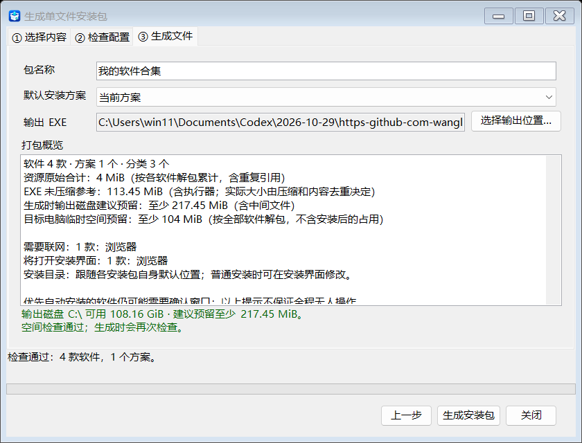

# 单文件软件合集使用指南

当前版本为 **v1.2.5**，生成的合集已恢复内置 .NET 9，不再要求单独安装 Framework 4.8 或 .NET 9；制作工具也自带 .NET 9。保留默认目录、队列及 Win7 父子进程跟踪等修复，相比 v1.2.4 的轻量版，首次启动和模板体积可能增加。.NET 9 官方不支持 Win7，仍需在实际目标电脑测试，内置运行时不等于新增系统兼容保证。v1.2.4 的 Framework 模板属于旧部署方式，历史性能记录见 [启动优化记录](runner-startup-optimization.md)。

## 最简单的操作

1. 打开 `软件安装助理.exe`，点击「加载配置」选择已有 JSON；或先点击「新增分类」，在左侧选中分类后，再新增或拖入一个或多个 EXE / MSI 安装文件。
2. 软件名默认从文件名填充。单个软件可编辑全部常用字段；批量导入时统一确认名称、分类和版本，重复路径自动跳过。静默参数可以留空，MSI 无需填写。
3. 按需要勾选软件并保存方案，再点击「保存配置」选择 JSON 存放位置。也可不勾选，生成时默认打包全部。
4. 点击「生成单文件安装包」，选择范围、默认方案和输出位置。
5. 把新生成的 EXE 复制到目标 Windows x64 电脑，打开、选择方案、点击「一键安装」，无需为合集另装 .NET 或 Framework。需要操作时，按软件原有安装窗口完成即可。具体软件与运行时的系统兼容性仍需在目标电脑确认。

## v1.2.5 界面示例

以下截图由最新版发布程序及实际生成的单文件 EXE 渲染，使用示例配置展示操作位置；发布包不包含示例安装源。

管理端主界面：


生成前的配置检查与概览：





生成后的单文件安装器（目标电脑打开此界面）：


## 新增 / 编辑软件

主界面列表显示全部软件，通过复选框选择；搜索和分类筛选不会清除隐藏项目的勾选。必须先创建并选中分类，再添加或拖入软件，选中「所有软件」根节点时不能添加。双击软件可编辑。多选或拖入多个安装文件后，在同一个确认窗口修改名称、分类、版本，也可统一指定已有分类；导入后仍可逐个编辑目录等设置。新增分类请回到主界面创建。

手动排序：点击左侧分类或软件名称使其高亮，再用分类树下方「上移 / 下移」调整同级顺序；「所有软件」根节点不可移动。右侧列表高亮软件后，用列表下方「上移 / 下移」排序，支持 Ctrl / Shift 多选。筛选时只在当前可见项目之间移动，隐藏项目保持原位置。点击名称仅选中，是否安装仍由复选框决定。调整后点击「保存配置」保存顺序；已有保存方案如需采用新顺序，请重新保存该方案。实际安装仍以软件的「安装顺序」和前置依赖为准，相同安装顺序时按列表顺序处理。

页面只有十行，输入框在左侧，右侧直接显示简易说明。正常窗口和最小窗口均不需要纵向滚动。

| 字段 | 用法 |
| --- | --- |
| 软件名 | 默认使用安装文件名（不含扩展名），可直接修改。更换安装文件时更新自动名称，保留手动改过的名称。 |
| 分类 | 只能选择已有分类；请先在主界面创建新分类。空分类也会保存。 |
| 版本 | 可留空，选择安装文件时尽量自动读取。 |
| 说明 | 可选，记录用途或注意事项。 |
| 安装文件 | 支持 EXE、MSI；识别时只读取文件，不执行安装器。 |
| 默认安装目录 | 制作工具直接安装时使用的可选配置。新生成的合集始终使用安装包自身默认位置，不会把这里保存的 D 盘等目录传给安装器；手动安装时可在安装器中自行修改。 |
| 关联资源目录 | 可选。依赖 CAB、配置等文件时，选择包含安装文件的源目录，会一同打包子目录。 |
| 静默参数 | 可留空。程序尽量自动选择参数；无法识别则打开普通安装界面。 |
| 联网需求 | 勾选后仍能打包，目标电脑需要联网下载该软件所需内容。 |
| 安装顺序 | 数字越小越早安装，默认 0。 |

原有配置中的超时、返回码、检测和依赖等后台数据继续保留，普通用户无需编辑这些项目。新软件使用默认值。不要求先实际安装一次或勾选验证状态才能打包。

## 默认目录与静默参数

目录参数类型默认「自动识别」，无需手动填。程序尝试识别常见 NSIS / Inno 文件特征；MSI 使用 Windows Installer，只读检查目录表，能够确定目录属性时自动设置。

无法确定类型或 MSI 目录属性时，不猜测目录参数。若填写了目录，会打开原有安装界面，请在其中选择目录，安装列表也会标注「安装时选择」。可自动设置目录时，目标磁盘不存在会报告错误。

如明确知道安装器类型，可在右侧选择手动方式，每种类型都有说明：

- Inno Setup：通过 `/DIR` 指定位置；常见静默参数为 `/VERYSILENT /NORESTART`。[官方参数说明](https://jrsoftware.org/ishelp/topic_setupcmdline.htm)
- NSIS：常见静默参数 `/S`；目录 `/D=...` 自动放在末尾且不加引号。[官方参数说明](https://nsis.sourceforge.io/Docs/Chapter3.html)
- MSI 目录属性：仅在明确知道厂商属性时手动填写，例如 `INSTALLDIR`。MSI 默认静默和普通安装命令由程序生成。[官方命令说明](https://learn.microsoft.com/windows-server/administration/windows-commands/msiexec)
- 自定义：仅供了解厂商参数时使用，模板含 `{InstallDir}`，例如 `--install-dir="{InstallDir}"`。

常见参数不是所有 EXE 都通用。静默安装器退出并报告失败时，默认清空静默参数，再打开一次普通安装界面；此时请在窗口确认安装位置。普通安装失败后不会反复重试。用户取消、等待超时或后台结果不确定时，也不会自动再次打开安装器。

## 生成与使用

合集界面的分类筛选旁有一个不带文字的复选框。勾上时全选当前分类，取消勾选时清空当前分类的选择；部分软件被选中时显示半选状态。逐项勾选会同步更新该复选框，切换分类不会影响其他分类的选择；选择「全部分类」时控制所有软件，空分类时禁用。安装期间不能修改勾选。

分类、方案初始化后统一显示一次列表；全选和切换方案只同步复选框，保留当前高亮行及滚动位置，切换分类时才重建可见列表。打开合集时建立本次使用的排序结果及软件 ID 索引，勾选变化时复用索引计算依赖，安装引擎直接执行已验证的顺序。提权后的进程直接恢复传入的选择，不再先应用默认方案再覆盖选择。

主界面和合集中的软件名称前显示安装文件图标，合集内嵌图标后不依赖原安装源路径；没有可读取图标的文件使用默认图标。两处界面均显示「本软件由 GitHub 用户 wanglanaaa 制作」。已有合集需要使用新版重新生成，才能显示新的图标与勾选交互。

默认打包当前列表全部软件，当前勾选状态作为「当前方案」；没有勾选时自动创建「全部软件」方案。也可只打包勾选项，附带当前配置内保存的方案；相关软件和前置依赖会一并加入。分类目录含空分类，相同资源按 SHA-256 内容去重。每次打开生成窗口均重新检查，返回选择内容后清空上次检查结果。

检查通过后，向导显示本次软件、方案、分类和资源统计。生成页的「打包概览」列出需要联网、将打开安装界面、需要手动选择目录的软件，并显示以下空间参考：

- 资源原始合计：读取安装文件及关联目录中的实际大小，按各软件分别累计，含重复文件引用；不使用软件列表里可能过时的大小文字。
- EXE 未压缩参考：资源合计加执行器开销。实际压缩和内容去重后大小会变化，并非最终文件大小；超过单文件上限时只提示，最终容量仍在生成时检查。
- 输出磁盘建议预留：包含中间文件的保守估算；选择输出位置后显示该磁盘可用空间，生成时再次检查。
- 目标电脑临时空间：按合集全部软件解包并附加预留量估算，选择部分方案时可能更少；不包含软件安装后自身占用或厂商安装器的额外临时空间。

概览不会额外执行完整哈希或压缩；自动安装的软件也可能需要确认窗口。最小窗口下可以滚动查看完整说明。

生成过程中可以取消，只有全部生成完成才替换已有输出。旧版生成的 EXE 不会自动变化，修改分类、目录或安装方式后需要重新生成。

目标电脑的安装界面提供方案、分类筛选和勾选。切换分类会保留隐藏项目的勾选，一键安装包含所有已勾选项目。完整离线安装器可离线安装；联网安装器会标注联网需求。

安装按依赖顺序逐项检查、解包和执行，不必先解包全部选中软件才开始第一项。已满足安装检测规则的项目，以及因前置软件失败而跳过的项目，不解包资源。仍串行运行安装器，避免低配置电脑上同时争用磁盘和安装服务。

界面显示检查条件、准备资源、正在安装、等待你操作、验证结果等阶段，以及已处理数量和完成、失败、取消、跳过、需重启结果。解包进度按当前软件实际写入的字节计算，刷新约每秒最多 10 次并保留最终完成更新；安装器没有提供真实百分比时显示等待动画。软件列表分批加载，结束后的临时目录清理在后台执行，减少界面长时间无响应。静默不可用时会出现普通安装窗口，可能需要点击「下一步」或确认条款。

合集界面的「取消安装」会中断资源准备、停止后续任务，并终止当前安装器及其受控子进程。安装中关闭窗口同样先取消，等待受控进程退出后再清理和关闭。取消或超时不会重新打开安装器；强制终止可能留下未完成的安装，需要之后检查或修复。

合集中的 EXE 和 MSI 客户端先挂起启动，建立跟踪后再运行。Win8 及以上优先使用 Job Object 并设置退出保护；Win7 直接使用父子进程跟踪，其他系统加入进程组失败时也自动切换，不再仅因无法加入进程组而阻止安装。等待安装器主进程退出后，继续等待安装资源目录、系统临时目录和 Windows 目录内的已跟踪子进程；位于这些目录之外的程序保留运行，继续下一项。系统 `conhost.exe` 不单独阻塞队列。正常完成解除进程组的关闭终止保护，避免误杀已安装软件；取消时终止受控进程组及已跟踪的独立子进程。无法确认进程路径时继续等待，日志记录正在等待的 PID、路径和资源目录。特殊安装器如果从其他目录启动实际安装进程，或把后台程序放在临时目录，需要结合日志验证。父子跟踪模式不具备系统 Job 在合集异常退出时自动终止子进程的保障，采样也可能漏掉转瞬即逝的中间启动器。

未填写静默参数且未识别到静默安装方式的单文件程序会正常打开，退出后继续队列。识别为 NSIS/Inno Setup 的自解压程序仍可能被当成安装器，具体软件需要复测。合集不覆盖配置文件中的原始目录设置，但会忽略旧目录及绑定到该目录的文件检测规则，避免实际使用默认位置后仍检测旧的 D 盘。

交互 EXE 允许外壳显式启动脱离本次进程组的子程序，避免部分自解压外壳因进程组约束出现“拒绝访问”。运行时补充读取父子进程关系快照，只跟踪本次后代；取消会终止已跟踪的独立子进程。两个采样点之间即退出的中间进程可能无法被观察到，特殊外壳仍需实机验证。合集启动、静默安装及 MSI 不增加这项快照查询，不修改磁盘权限或安全软件配置。

安装完成判断以当前安装进程退出及成功返回码为基础；没有适用检测规则时，不再额外等待。配置了独立文件/版本或 MSI 产品码时才复核，失败时最多重试约 10 秒，仍失败则暂停队列。进程正常退出不保证用户没有在软件内部取消，也不保证软件实际安装成功。资源 SHA-256 在当前软件提取时顺便计算，用于阻止损坏资源运行，与安装完成检测是两回事；没有全盘扫描。

MSI 的 Windows Installer 服务可能在客户端退出后继续回滚；不会按名称批量结束系统中的安装服务或其他安装任务，此时标记待检查并保留资源。由系统服务另行启动的任务也不属于受控子进程。没有检测规则的项目仍只表示安装器报告成功，特殊安装器需要人工确认实际结果。

## 日志与限制

日志位于运行账号的 `%LOCALAPPDATA%\SoftwareInstaller\Logs`，导出端提供「查看日志」。包含 `session.log`、`results.json`，MSI 另有详细日志；资源保留时记录在 `retained-resources.txt`。

- 当前执行器和制作工具均使用 Windows x64 自包含 .NET 9 发布。合集内带运行库，不依赖目标机的 Framework；Win7 不属于 .NET 9 官方支持系统，必须实机确认。
- 单文件上限约 3.4 GiB，包含内置运行时的固定体积。运行时按单文件部署方式装载；安装资源仍使用 ZIP 存储模式并保留去重，按需提取和同步资源校验不变。
- 无重启自动续装、统一回滚、分卷和 ARM64 支持。安装器重启行为取决于其支持的参数。
- 当前主要使用管理员安装流程，用户级安装器需按软件验证。
- 保留原有容器格式和生成时 SHA-256 去重。启动只读取清单，不扫描所有资源；当前软件提取时检查路径、存在性、长度并同步验证 SHA-256，拦截同长度损坏后再执行。该校验用于发现损坏，不等同于发布者签名。容器尚不支持生成后直接追加 Authenticode 签名。

## 配置与安装源搬家

保存时，安装文件和关联资源目录尽量写成相对于 JSON 的路径；同磁盘的相邻目录也支持，跨磁盘路径保留绝对路径。「另存为」会根据新 JSON 位置重新计算，默认安装目录等设置不受影响。

建议把配置 JSON 和安装源放在同一个总文件夹中，搬家时复制整个总文件夹并保持子目录结构。例如 `软件库/安装配置.json` 与 `软件库/安装源/...` 一起移动后，在新位置手动加载 JSON 即可。只移动 JSON 而不移动安装源时，如路径失效，请使用下述修复功能。

旧配置的绝对路径失效，或资源根目录改变时：

1. 手动加载配置，点击顶部「修复路径…」。
2. 填写原资源根目录，选择新的对应目录。例如原 `F:\软件库`、新 `E:\软件库`；原目录可以已不存在，直接输入即可。不同资源库可分多次修复。
3. 点击「预览修复」，按列表确认软件、所属方案、原 / 新位置和检查结果。位置列按所选根目录显示，悬停可查看完整路径。
4. 保留需要修复的勾选，点击「应用修复」，返回主界面后点击「保存配置」。

修复涵盖当前列表和已保存方案中的安装文件及关联目录。已有有效路径保持原样，不会移动或删除真实文件。程序只按子目录结构匹配，不会猜测同名文件；未找到的项目或不属于原目录的项目不能应用，需要调整根目录后重试或单独编辑软件。分类、排序和安装勾选保持不变。

## 开发与检查

Windows / .NET 9 SDK：

```powershell
.\scripts\publish-portable.ps1
dotnet run --project SoftwareInstaller.Tests
```

输出 `artifacts/portable` 为管理端便携版，分发时保留整个目录及 `Runner` 子目录。`artifacts/runner/SoftwareInstaller.Runner.exe` 是预编译模板，用户生成合集时不调用 SDK。

制作工具和自包含执行器首次发布需要还原微软运行时；可通过脚本的 `-NuGetConfig`、`-PackageCache` 指定配置和缓存。`-OutputDirectory` 可选择新的发布目录，避免混入旧构建文件。调试主界面可执行 `dotnet run --project SoftwareInstaller.UI`。后续用户明确要求更新模板时，可单独运行 `.\scripts\build-runner.ps1`，再构建管理端；已为 win-x64 还原依赖时可加 `-NoRestore`。生成检查会拒绝不匹配的旧模板。

开发阶段按 `AGENTS.md` 以编译和必要的定向检查为主，用户要求打包时再发布。调试预览为 `SoftwareInstaller.UI/bin/Debug/net9.0-windows/软件安装助理.exe`。当前构建和后续便携包的主程序统一使用此中文文件名；已发布的 v1.2.0 保持原文件名。

排序改动可用 `dotnet run --project SoftwareInstaller.Tests -- --ordering-only` 做 9 项针对性检查，并渲染最小和放大主界面；无需重建执行器或打包。

配置搬家可用 `dotnet run --project SoftwareInstaller.Tests -- --resource-paths-only` 做 14 项针对性检查，覆盖相对路径保存、整库移动、另存为、跨盘路径、批量修复及界面预览；测试文件全部位于隔离目录。

打包概览可用 `dotnet run --project SoftwareInstaller.Tests -- --overview-only` 做 10 项针对性检查，并渲染检查页和生成页的默认 / 最小窗口；不实际安装软件或生成正式发布包。

自动检查只运行无副作用的安装器替身，用户数据隔离在测试目录。`--first-round` 针对批量导入、列表筛选、模板版本、实际导出 EXE 图标和安装状态进行 13 项检查；需先重建执行器模板。`--configuration-only` 仅检查手动配置及生成向导流程，`--settings-only` 运行配置和识别检查，`--ui-only` 另外渲染界面；完整测试包含真正的一分钟超时。结果和预览位于 `.build/integration-*`。

进程控制可用 `dotnet run --project SoftwareInstaller.Tests -- --process-control-only` 做 11 项针对性检查，覆盖启动前停止、原有调用语义、启动器提前退出、合集取消父子进程及日志；不运行第三方安装器、不重建发布模板。读取与解包可用 `--bundle-reading-only` 做 9 项针对性检查。

执行器流畅度可用 `dotnet run --project SoftwareInstaller.Tests -- --runner-performance-only` 做 17 项针对性检查，覆盖安装计划复用、非法依赖、逐项准备资源、检测跳过、准备失败及取消，以及方案切换保留滚动位置、分类与勾选同步、安装中关闭窗口先取消，并渲染包含 120 款演示软件的默认 / 最小窗口；不生成正式合集或重建发布模板。源码编译不会自动更新 `artifacts/runner`，需在后续明确构建执行器模板并重新生成合集后，目标电脑的 EXE 才会包含这些改动。

生成的 EXE 支持诊断模式，按需检查基础结构、提取并校验全部资源，不执行安装。此模式显式请求全量提取，与普通启动路径不同：

```powershell
.\软件合集.exe --verify-package .\verification.json
```

诊断报告包含执行器版本及 LOGO 原图尺寸；可追加 `--preview .\preview.png` 渲染该 EXE 自身的安装界面，不执行安装。

发布前仍需在目标系统验证自包含执行器及实际软件安装；本地 Win11 的检查不能代替 Win7 实机验证。

## 数据位置

每次启动为空白，不自动读取 `%APPDATA%\SoftwareInstaller`、程序目录或上次的配置文件。

- 「保存配置」首次选择存放位置，将当前软件列表、勾选、空分类及全部方案存入一个 JSON；以后保存到当前文件。「另存为」选择另一个位置。
- 「加载配置」手动选择 JSON，完整替换当前软件、分类和方案；不会合并旧分类。加载失败保留当前内容。
- 「新建配置」清空当前工作内容，开始独立配置。新建、切换或退出前，如有未保存修改，会提示保存。
- 「保存方案」只记录到当前工作内容，仍需点击「保存配置」持久保存。
- 旧的 `software_list.json`、`categories.json`、`schemes.json` 可以手动加载导入，旧文件保留。导入旧方案后从下拉框选择所需方案，再另存为新的完整配置。
- JSON 不包含安装文件本体；安装包及关联资源仍需位于记录的路径。保存时尽量使用相对路径，加载时按 JSON 所在文件夹解析。生成时实时检查文件是否可用，检查结果不保存到配置。
