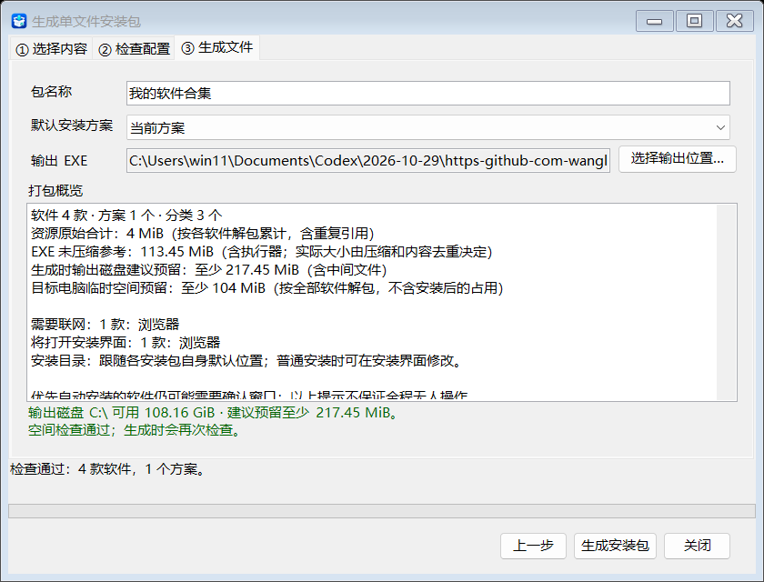

# v1.2.1 — 批量添加、手动排序与配置搬家

发布日期：2026-11-04。

## 新增及改进

- 主程序更名为「软件安装助理.exe」。主界面按钮统一对齐，右下角放大 LOGO，「更新版本」按钮打开项目页面。
- 修复导出安装器页眉 LOGO 模糊的问题，直接使用 1254×1254 原始 PNG；生成前检查执行器版本，避免误用旧模板。
- 主列表始终显示全部软件，支持搜索、分类筛选和直接勾选；过滤后保留隐藏软件的勾选。
- 多选或拖入 EXE / MSI 批量添加，自动填充名称、版本及大小，集中确认分类并跳过重复路径。
- 分类及软件支持上移 / 下移，软件支持多选；顺序随配置保存，不改动已有安装优先级或依赖关系。
- 配置自动保存相对安装源路径，方便整套目录搬家；新增「修复路径…」，预览后批量修复当前列表与已保存方案中的失效路径。
- 生成前展示软件 / 方案数量、资源大小、空间参考，以及联网、普通安装和手动目录选择提示；选择输出位置后显示可用空间。
- 安装器区分检查、安装、等待用户操作和验证阶段，显示已处理数量及逐项结果；没有真实进度时显示等待动画。
- README 与使用指南更新为本版主界面、软件设置、生成向导和实际导出 EXE 的截图。

## 使用

下载并完整解压 `SoftwareInstaller-Assistant-v1.2.1-win-x64.zip`，双击「软件安装助理.exe」。保留旁边文件及 `Runner` 子目录，无需预装 .NET。

程序每次启动为空白，手动加载已有 JSON 或新增软件，再保存配置。更新后的分类、目录和界面需要用新版重新生成安装合集；已经生成的旧 EXE 不会自动变化。

截图仅使用示例配置展示界面。发布包不附带示例或任何第三方软件安装源，也不会自动安装示例项目。

## 界面预览

## 验证及限制

发布前 65 项针对性检查通过，涵盖执行器与实际导出、批量添加、分类与软件排序、配置搬家、打包概览、手动配置流程和图标。文档截图取自发布程序集及实际导出的单文件 EXE，执行器版本和包内副本摘要一致。

构建成功；本次 NuGet 漏洞数据源不可达（NU1900），未完成联网漏洞数据检查，未关闭审计设置。

只支持 Windows x64，单文件合集上限约 3.4 GiB；联网安装器仍需目标电脑联网。真实第三方安装器的静默、管理员授权、重启及干净 Windows 环境仍需按软件验证，本次自动检查只使用无副作用替身。尚无统一回滚、重启续装、数字签名、分卷或 ARM64 支持。

详细用法见 [安装包指南](https://github.com/wanglanaaa/Software-Installer-Assistant/blob/v1.2.1/docs/offline-bundle-guide.md)。
