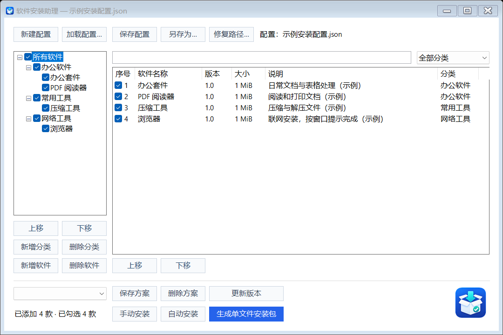
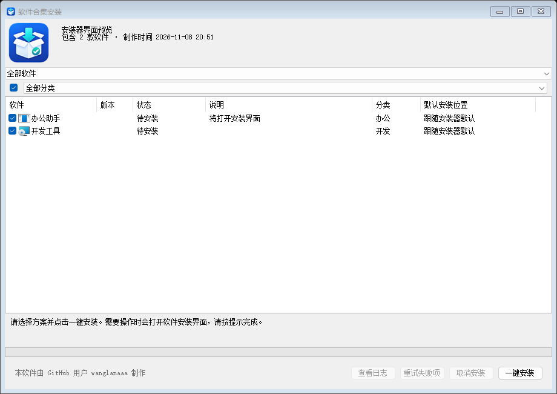

# v1.2.4 — 合集轻量启动与安装取消修复

发布日期：2026-11-08。

## 更新内容

- 仅优化生成的「软件集合.exe」；制作工具的界面、功能和操作流程保持不变。
- 合集执行器从约 109 MiB 的 .NET 9 自包含模板改为约 2.23 MiB 的 Framework 模板，直接使用系统已有运行环境，不释放随包运行库。
- 启动只读取界面及选择所需清单；各软件的资源检查延后到实际提取时。保留逐款按需提取、顺序安装、选择、一键安装、进度、错误提示和日志。
- 安装资源不再二次压缩，优先减少低配电脑的解压 CPU 消耗，保留内容去重；最终文件可能比快速压缩方式更大。
- 提取当前软件时，同一遍读取同步检查文件长度与 SHA-256，发现同长度损坏也会阻止执行；不增加整包启动扫描或解压后的第二遍读取。
- 「取消安装」和安装中关闭窗口会停止后续队列，并终止当前安装器及受控子进程，确认退出后再清理资源。安装器先挂起，成功建立进程管理后才运行；无法建立管理则阻止启动。超时同样暂停队列并处理受控进程。
- 生成器检查新模板版本与类型，避免误用旧的自包含执行器。

## 下载与运行条件

下载并完整解压 `SoftwareInstaller-Assistant-v1.2.4-win-x64.zip`，运行「软件安装助理.exe」，保留旁边文件与 `Runner` 子目录。**制作工具仍自包含 .NET 9，无需预装 .NET。**

**新生成的合集要求目标电脑预装 .NET Framework 4.8 或兼容的 4.8.1；Windows 7 需 SP1 和 Framework 4.8。只有 .NET 9 不能替代此环境。** 本版不自动下载或安装运行环境。Framework 模板可在相应的 32/64 位系统上运行，但软件安装器自身的架构和系统要求仍须满足。

加载原配置后重新生成合集才会包含改动；旧合集不会自动更新。发布包不附带用户配置、演示数据或第三方安装源；仅提供 ZIP 下载附件。

## 验证与限制

开发样例在 Win11 上首次启动从约 5.1–5.3 秒降到 1.2–1.4 秒；未清空系统磁盘缓存，这不是 Win7/Win10 或低配机的严格冷启动结果。重复启动略慢，私有内存增加，不能认为全部性能指标都降低。完整测量与边界见 [验证记录](https://github.com/wanglanaaa/Software-Installer-Assistant/blob/v1.2.4/docs/runner-startup-optimization.md)。

强制取消可能留下未完成的安装，需要检查或修复。MSI 客户端可以受控取消，但 Windows Installer 服务可能继续回滚，此时报告待检查并保留资源；不会批量结束其他系统安装任务。服务另行启动的任务不属于受控子进程。Win7 的嵌套进程组限制可能使某些环境无法建立管理，届时会阻止启动并提示错误。

Release 编译无警告、无错误；发布前使用实际发布组件完成 56 项定向检查，包含读取解包、顺序准备、进程取消、生成封装、导出流程，以及实际 Framework 执行器的按需提取和取消探针。实际导出 EXE 的独立启动、资源校验和界面预览通过。

尚未完成 Win7/Win10 实机、低配电脑或真实第三方安装器的完整验证，不新增这类实机兼容承诺。未运行默认完整回归或安装真实第三方软件。

## 界面预览

详细用法见 [安装包指南](https://github.com/wanglanaaa/Software-Installer-Assistant/blob/v1.2.4/docs/offline-bundle-guide.md)。
